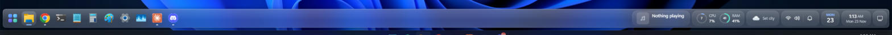
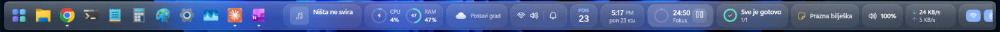

# NexaDock

A smart Liquid Glass bar for Windows 11, built with .NET 10 and WPF: Start, your pinned and running
apps, and live widgets in one glass strip, optionally replacing the Windows taskbar.





> **Status:** 0.4.0, Phase 4: a real taskbar replacement. Apps centred like Windows 11,
> notification icons, a bar on every display, Google Calendar, liquid glass, backup and updates.
> See [ROADMAP.md](ROADMAP.md) for what comes next and [ARCHITECTURE.md](ARCHITECTURE.md) for the
> design.

## What it does

- **Centred like Windows 11, edge to edge:**
  - Start and your apps stay in the middle of the bar, however many you pin.
  - Widgets before them start at the left edge; widgets after them end at the right edge.
  - Widgets are arranged in a logical order. Rearrange them by dragging, or right-click the bar ›
    **Arrange widgets**.
  - The bar sits flush on the screen edge like the Windows taskbar, and maximised windows stop
    exactly at the glass. Set an edge gap above 0 for a floating, rounded bar.
- **Apps widget:** a Start button, pinned apps and every open window, merged like a taskbar.
  - A pinned app lights up while it runs; other running apps appear after the pinned ones.
  - Click to launch, switch to, minimize or cycle through an app's windows.
  - **Hover a running app for live window previews** (DWM thumbnails); click a preview to switch
    to that window, or press × to close it.
  - Right-click an app to pin or unpin it, open a new window, or close its windows.
- **Live widgets.** Each widget is a glass tile on the bar; clicking a tile opens a card with
  details.

  | Widget | Tile | Card |
  | --- | --- | --- |
  | Clock | Time and date (12/24 h) | Seconds, week number, month calendar with event dots, your agenda |
  | Day Number | Calendar page | Month calendar with navigation |
  | Day Progress | Ring with today's progress | Day, week, month and year progress |
  | CPU & Memory | Two rings | Busiest apps by CPU and memory, uptime, Task Manager |
  | Weather | Icon and temperature | Conditions, feels-like, humidity, wind, 4-day forecast |
  | Now Playing | Cover art, title, play/pause | Large art, progress, previous/play/next |
  | Control Center | Network, sound, battery | Opens Quick Settings; the bell opens notifications |
  | Show Desktop | — | Hides or restores all windows |
  | Flexible Space | — | Pushes the following widgets to the far end of the bar |
  | **Pulse** | Appears only when something needs you | All alerts, with Dismiss |
  | **Focus** | Pomodoro ring, time left, start/pause | Big ring, skip, reset, focus and break length |
  | **Timer** | Countdown | Presets (1–60 min), +1/+5 min, start/pause, reset |
  | **Stopwatch** | Elapsed time | Hundredths of a second, laps |
  | **To-dos** | Next open task, progress ring | Add (type + Enter), tick off, delete, clear completed |
  | **Notes** | First line of your note | Multi-line note, saved as you type |
  | **Volume** | Level; scroll the mouse wheel to change it | Slider, mute, microphone mute, device name |
  | **Microphone** | Mic state; click to mute or unmute | — |
  | **Network Speed** | Download and upload rates | 60-second live chart |
  | **Storage** | Free space on the system drive | All drives with usage bars, Open This PC |
  | **Recycle Bin** | Item count | Open, Empty (Windows asks for confirmation) |
  | **Keyboard Layout** | Current layout (HR, EN…); click to switch | — |
  | **Quick Toggles** | Wi-Fi and Bluetooth on/off, Quick Settings | — |
  | **Brightness** | Level; scroll the mouse wheel to change it | Slider per display (laptop panel or DDC/CI monitor) |
  | **Claude** | Tokens in the current 5-hour session and time until it resets | Session details, today, 7-day chart, models |
  | **Notification Icons** | Pinned icons of background apps (Discord, Steam…) and a ^ button | Every icon; click and right-click go to the app; choose which are pinned |
  | **Up Next** | Your next calendar event and when it starts | The coming week in calendar colours |

- **Profiles:** separate widget layouts such as Work, Gaming and Study (built-in templates).
  - Switch from the bar's right-click menu › **Profile**.
  - Or switch automatically: an app in front (e.g. `steam.exe`) wins, then a schedule (time window
    and weekdays, overnight windows supported), otherwise the profile you picked last.
  - A switch waits until the result has been stable for 3 seconds, so a quick Alt+Tab past a
    trigger app does not reshuffle the bar.
- **Pulse:** the bar asks for attention only when needed.
  - Triggers: battery at or below 15% (critical at 7%), the system drive almost full, CPU busy for
    half a minute, or a finished Focus round or timer (with a sound and a notification).
  - The owning tile glows (steady with Reduced motion), and the Pulse capsule shows the alert.
  - A dismissed alert stays quiet until its condition clears and comes back.
- **Claude usage** is read from Claude Code's own logs on this PC (`~/.claude/projects`), with no
  sign-in and nothing sent anywhere.
  - Shows the current 5-hour session window (when it started and when it resets), today, the last
    seven days and the models used.
  - Anthropic does not publish exact plan limits, so the bar compares the session with your
    busiest session of the last 30 days. Pulse tells you when you pass 90% of that.
- **Overflow:** widgets that don't fit on the bar move behind a "›" button at its end. They stay
  live in that card.
- **Calendars** (Settings › **Calendars**):
  - **Google account:** sign in once and every calendar appears in its own colour. Tick the
    calendars the bar should show. See [Google Calendar setup](#google-calendar-setup).
  - **iCal addresses** of any other calendar. You can paste several at once.
  - The Clock card shows the coming week. The Up Next widget shows the next event, and Pulse
    lights up 10 minutes before a meeting.
- **Notification icons:** the icons of apps running in the background, hosted on the bar.
  - Pinned icons sit on the bar; the rest are one click away.
  - Clicks, double clicks and right-click menus go straight to the app.
- **A bar on every display:** each display gets its own bar with its own widgets.
  - Its Apps widget shows the windows open on that display.
  - Switch it off in Settings › Position & behavior › **Show a bar on every display**.
- **Liquid glass:** a specular edge, lens depth, light on tile edges and a soft light that follows
  the pointer. None of this costs anything while the bar is idle.
  - **Liquid refraction** (opt-in, Settings › Appearance) bends what is just above the bar into
    the glass edge.
  - It reads a thin screen strip only while the bar is visible, and only redraws when that strip
    changes (about 0.2 % CPU).
- **Backup:** Settings › About › **Export settings…** and **Import settings…** save or restore
  the layout, profiles, pinned apps, look, to-dos, notes and calendar links. Sign-ins are not
  included.
- **Updates:** NexaDock looks for a newer release on GitHub. Pulse tells you when one is out, and
  Settings › About › **Install and restart** updates it after checking the download's SHA-256.
- **Language:** English or Croatian (Hrvatski), or follow Windows. Switches live everywhere: the
  bar, cards, menus, Settings, the picker and the tray.

- **Widget picker:** right-click the bar › **Widgets…** to browse by category or search, and add or
  remove widgets. Changes apply instantly.
- **Arrange:**
  - Drag a tile along the bar to reorder it.
  - Right-click a tile › **Remove**.
  - Drag the bar by an empty spot to the top or bottom edge, or onto another display.
- **Styles:** Liquid Glass, Onyx, Pearl, Midnight and Aurora, on a native acrylic blur.
- **Sizes and layout:** S, M or L sizes. Full width (like a taskbar) or compact (fits the widgets).
  Adjustable spacing, opacity and edge gap, plus reduced motion.
- **Behavior:**
  - **Replace the Windows taskbar** (opt-in).
  - Hide during full-screen apps.
  - Start with Windows.

## Requirements

- Windows 11 build 22621 (22H2) or newer for the native acrylic backdrop. Older builds get a
  translucent fallback.
- .NET SDK 10.0 (verified with 10.0.404) on x64.

## Build, test, run

From the repository root:

```powershell
dotnet build NexaDock.slnx
```

```powershell
dotnet test tests/NexaDock.Tests/NexaDock.Tests.csproj
```

```powershell
dotnet run --project src/NexaDock.App
```

Or start the built executable:

```powershell
.\src\NexaDock.App\bin\Debug\net10.0-windows10.0.19041.0\NexaDock.exe
```

Release build (framework-dependent, needs the .NET 10 Desktop Runtime):

```powershell
dotnet publish src/NexaDock.App -c Release -r win-x64 --self-contained false -o publish
```

### Install for everyday use

`tools\install.ps1` installs NexaDock for the current user:
- builds a Release version into `%LOCALAPPDATA%\Programs\NexaDock`
- closes a running copy cleanly
- adds a Start menu shortcut
- starts it

```powershell
powershell -ExecutionPolicy Bypass -File tools\install.ps1
```

`tools\uninstall.ps1` removes the program, the shortcut and the startup entry. Settings, to-dos and
notes are kept unless you add `-RemoveData`.

```powershell
powershell -ExecutionPolicy Bypass -File tools\uninstall.ps1
```

### Releases and updates

`tools\package.ps1` builds `dist\NexaDock-win-x64.zip` and `dist\NexaDock-win-x64.zip.sha256`:

```powershell
powershell -ExecutionPolicy Bypass -File tools\package.ps1
```

Publish them on GitHub as a release tagged `v<version>`, for example `v0.4.0`, matching
`ProductInfo.Version`. Installed copies find the release, verify the SHA-256 and update themselves.

GitHub only serves releases of a **public** repository without signing in. While the repository is
private, update with `tools\install.ps1` instead.

### Options

| Option | Effect |
| --- | --- |
| `NexaDock.exe --exit` | Closes a running NexaDock cleanly (restores the taskbar if it was replaced). |
| `NexaDock.exe --wait-for <pid>` | Starts once process `<pid>` has exited (used by restart and updates). |
| `NexaDock.exe --settings` | Opens Settings. Also works while NexaDock is running: the running instance opens it. |
| `NEXADOCK_BACKDROP=fallback` | Forces the translucent (no-blur) surface, for testing. |
| `NEXADOCK_DATA_DIR=<path>` | Stores the database and logs in `<path>` instead of `%LOCALAPPDATA%\NexaDock`. |
| `NEXADOCK_LOG=debug` | Writes verbose diagnostics to the log. |

Starting NexaDock again while it runs only brings its bar back.

## Replacing the Windows taskbar

Settings › Behavior › **Replace the Windows taskbar**. While it is on:

- The Windows taskbar is set to auto-hide and its windows are hidden.
- NexaDock registers as an *app bar*, so maximized windows stop above it.
- The Windows key still opens Start.

When you turn it off or quit NexaDock, the taskbar's previous state is restored exactly. That state
is saved before anything changes, so the taskbar is also restored after a crash: on the next start,
or from the crash handler. NexaDock never modifies Windows files.

## Google Calendar setup

Google requires every app that reads calendars to have an OAuth client. Create your own client
once in [Google Cloud Console](https://console.cloud.google.com/apis/credentials):

1. Create a project, for example "NexaDock".
2. Enable the **Google Calendar API**.
3. Open **OAuth consent screen** (Google Auth Platform) › **Get started**.
   - App name: NexaDock. Use your address for support and contact.
   - Audience: **External**.
   - Don't upload a logo: an app with a logo has to be verified.
4. Under **Audience** › **Test users**, add your Google address.
5. Under **Clients** › **Create client**, choose **Desktop app**.
   - Copy its client ID and client secret into NexaDock › Settings › Calendars › **Save**.
6. Click **Sign in with Google**. On "Google hasn't verified this app", choose **Advanced** › **Go
   to NexaDock**. The app is yours, so this is expected.

While the Google project is in **Testing**, Google asks you to sign in again every 7 days. Pulse
reminds you when that happens. Publishing the app (Audience › Publish app) removes the limit, but
Google may then ask for a home page and a privacy policy.

## Privacy

- **Weather:** only the city name you enter, and its coordinates, are sent to
  [Open-Meteo](https://open-meteo.com) (free, no account).
- **Google Calendar:** read-only access (`calendar.readonly`) through your own OAuth client.
  - Sign-in happens in your browser; NexaDock never sees your password.
  - The sign-in token and client secret are stored encrypted for your Windows account.
  - **Sign out** also revokes NexaDock's access.
- **iCal links** are fetched directly from their address. Treat a secret address like a password.
- **Updates:** NexaDock asks GitHub's public API for the latest release. Nothing about you is sent.
- **Everything else is read locally:** the window list, media sessions, CPU, memory, battery,
  audio devices, network counters, drives and brightness.
- **To-dos and notes** are stored only in the local database.
- No telemetry and no account. Settings live in
  `%LOCALAPPDATA%\NexaDock\nexadock.db` (SQLite) and logs in `%LOCALAPPDATA%\NexaDock\logs\`.

## Known limitations

- **Claude usage:** only Claude Code on this PC is counted. claude.ai in the browser and other
  devices are not included, because their usage is not stored locally.
- **Google sign-in** expires every 7 days while your Google project is in Testing (see
  [Google Calendar setup](#google-calendar-setup)).
- **Extra bars** use the main bar's edge and size. They were tested with unit tests; check a live
  second display yourself.
- **Audio output device:** the Volume widget changes the default device but cannot switch to
  another device. Windows has no documented API for that.
- **Brightness:**
  - External monitors need DDC/CI switched on in their own on-screen menu.
  - Some monitors answer slowly.
- **Untested on this machine:**
  - Brightness changes: the widget lists displays, but I did not move the sliders on your monitor.
  - Toggling the Wi-Fi/Bluetooth radios.
  - Emptying the Recycle Bin: it deletes data, so I left it for you.
  - Pulse alerts for battery and disk: there is no battery here and the disk is not full. The rules
    are unit-tested.

- **Native corners:** with the native blur, the bar uses the DWM corner radius (~8 px). The fully
  rounded pill shape exists only in the translucent fallback.
- **Notification icons:** the system's own icons (network, volume, battery) are part of Windows 11's
  Quick Settings, not of the notification area. Reach them through the Control Center widget.
- **Untested on hardware:**
  - mixed-DPI and high-DPI displays (both test displays were at 100%)
  - unplugging a monitor while the bar runs
  - touch and pen input
  - battery display (no battery on the test machine)
  - the **Replace the Windows taskbar** switch itself: it changes a Windows setting, so it was left
    for you to try
- **Store apps:** they are pinned through their Start menu shortcut, or by right-clicking a running
  app › **Pin to bar**.
